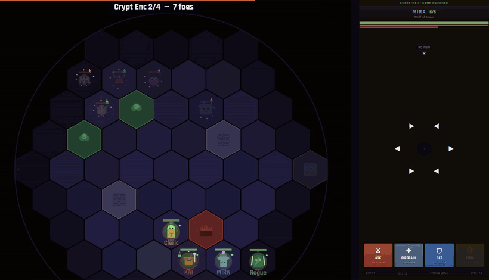
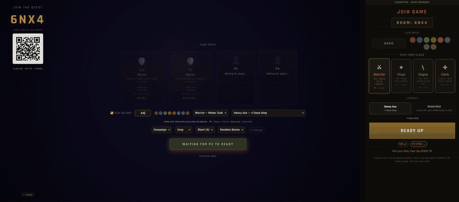
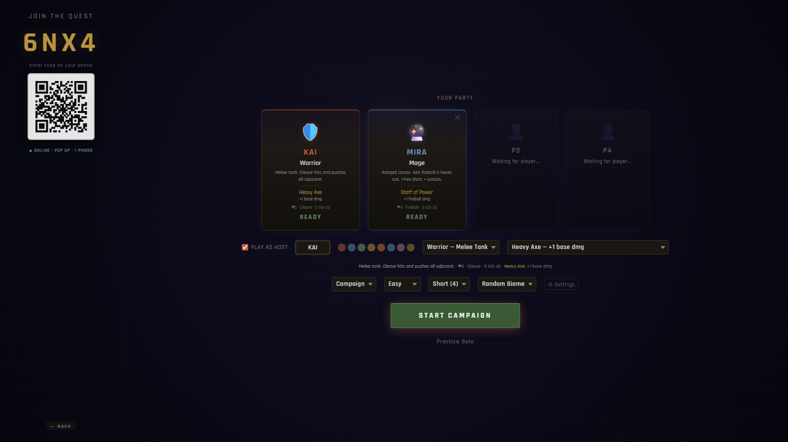
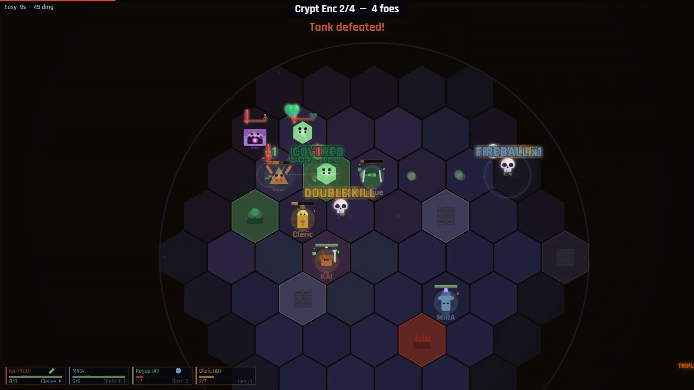
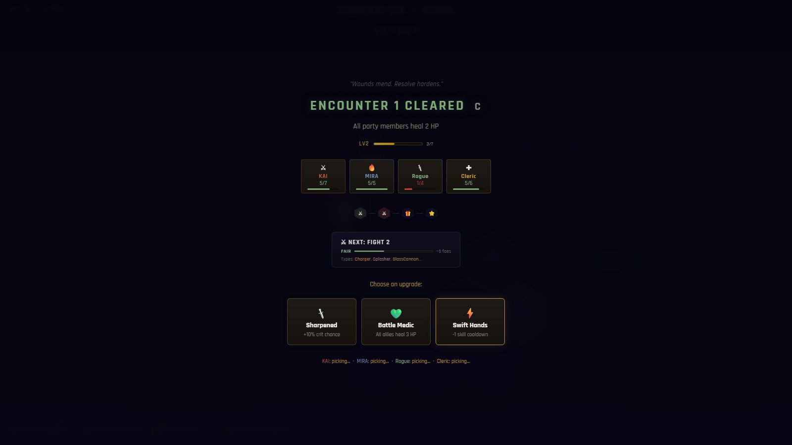
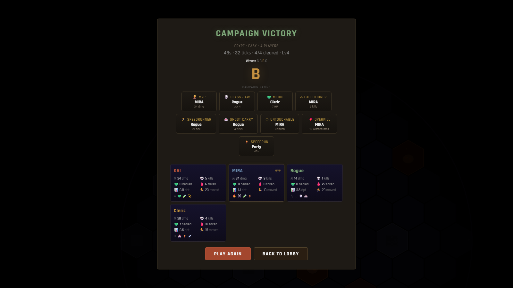
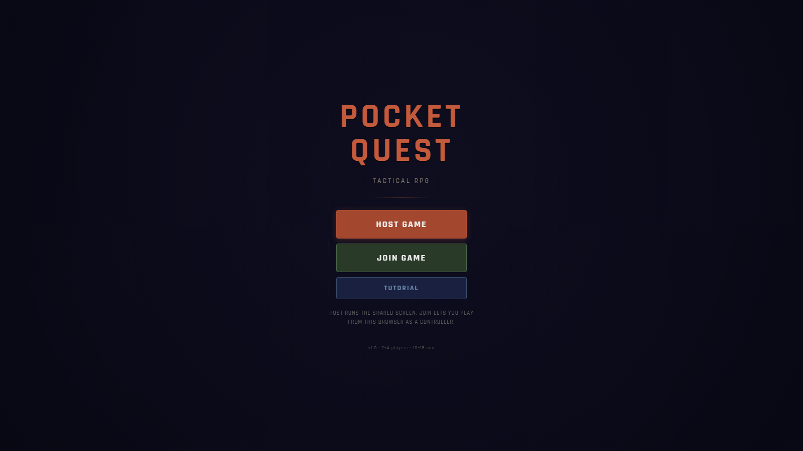
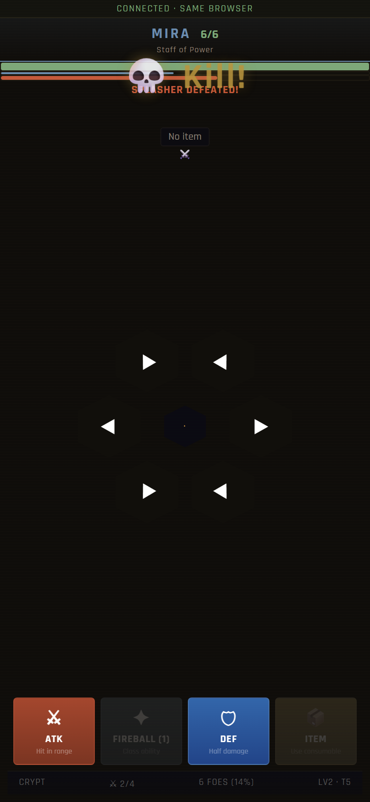
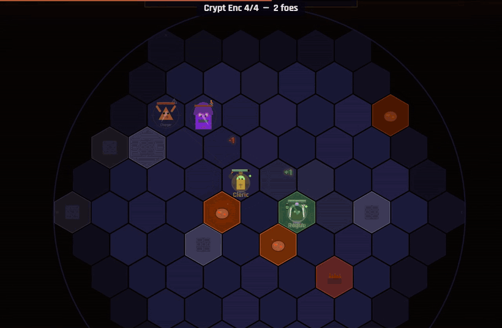

# Pocket Quest

> "Jackbox made me think, why not for RPGs? So I built one. Scan a code, your phone's the controller, and you're playing."

Multiplayer tactical RPG that runs entirely in the browser. One screen hosts the game, everyone else joins on their phones — no installs, no accounts, no servers to rent. Built for Discord screenshare and couch play.

**[Play it now](https://hansvidaure24.github.io/Pocket-Quest/)**

On your own? **Host Game → Practice Solo** plays with bot teammates, or open **Join Game** in a second tab to be the phone yourself.

  

## What it is

- **2–4 players, 10–15 minute sessions.** Host shares their screen (TV, Discord screenshare, projector). Players scan a QR code and their phone becomes their controller.
- **Tick-based combat.** Every 1–1.5 seconds, everyone inputs simultaneously on their phones. All moves resolve at once — it feels real-time but stays readable and tactical.
- **Two modes.** Campaign (4 encounter zones, events, boss fight) and Survival (endless waves with per-wave upgrades, relics, and elites).
- **4 classes** (Warrior, Mage, Rogue, Cleric), each with 2 loadout options.
- **11 enemy types, 5 bosses**, all with telegraphed AI patterns players can learn and exploit.

## How it works

The host page runs all game logic and renders the board on an HTML5 Canvas. Phone controllers are a separate lightweight page that sends inputs over the network and displays your HP, cooldowns, and nearby threats.

  

Networking tries three transports in order: same-browser (`BroadcastChannel`), WebSocket relay (Cloudflare Worker), and peer-to-peer (WebRTC via PeerJS). If any phone drops, it reconnects automatically and keeps its player slot.

## Screenshots

  
  

  
  

  
  

  

## Tech

Zero dependencies for the game itself. No frameworks, no build step, no bundler.

- Vanilla JavaScript (ES modules, no bundler) + HTML5 Canvas
- WebRTC (PeerJS) for peer-to-peer
- Cloudflare Workers + Durable Objects for the relay (free tier)
- Web Audio API for sound
- GitHub Actions → GitHub Pages for deployment

~10,000 lines of JavaScript in 27 files. The host, phone and menu pages are ES modules; the game's modules share one `state` object, and the networking layer is a plain script both pages load.

## Tests

- **Unit tests** import the real game modules in Node (canvas and DOM stubbed) and check hex math, combat rules and game data, including that the counts in this README are right. `npm test`
- **Self-play:** a headless browser hosts a game, joins a phone over the same-browser channel, and lets the bot AI play Practice Solo, a full campaign (with the phone's board view open) and three Survival waves. Any page error fails the run. `npm run test:selfplay`

Both run on every push. The npm packages are dev tooling only; the game still ships with none.

## Design decisions

**No frameworks or build step.** The game has to load instantly on any phone browser. One link, playing in seconds.

**Host-authoritative.** All logic runs on the host screen. Phones are thin clients — fast on any device, nothing to desync.

**Facing as targeting.** Attacks aim where you last moved. No target button needed on a small phone screen.

**Dead players keep playing.** Ghosts can't attack but they buff adjacent allies and body-block enemies. Nobody sits out.

## What was hard

**Hex movement on a phone.** Six directions don't fit a normal d-pad. Ended up with swipe input and tuned dead zones until diagonals felt right.

**Peer-to-peer without a server.** Reconnection, rate limiting, and keeping the game going when a phone drops all had to be handled manually.

**Trade-off.** No server means no saves, no matchmaking, and the game dies if the host leaves. For a 15-minute session with friends, that's fine.